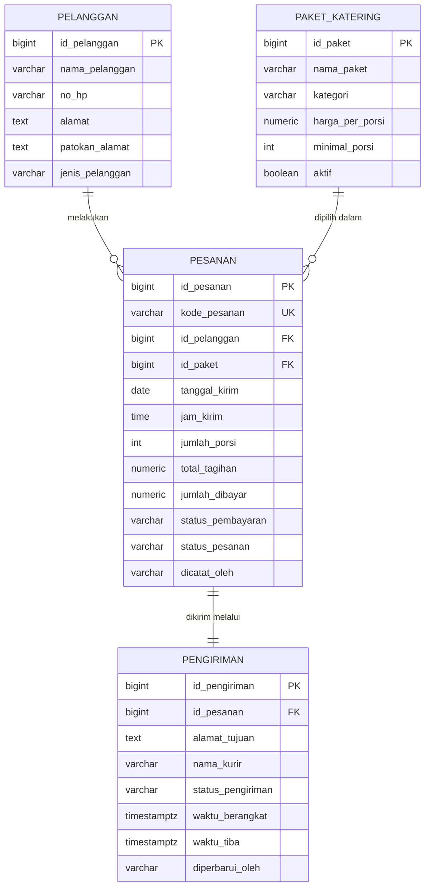

# Sistem Informasi Akuntansi Pendapatan pada Usaha Katering

**Studi kasus: Katering Dapur Tembalang, Semarang**

Aplikasi web Sistem Informasi Akuntansi (SIA) untuk mencatat pesanan, pilihan paket, pengiriman ke alamat pelanggan, pembayaran, dan pengakuan pendapatan pada usaha katering. Aplikasi dibangun dengan HTML, CSS, dan JavaScript di sisi frontend, backend `app.js` (Node.js), serta basis data PostgreSQL melalui Supabase.

**Web demo:** `https://USERNAME.github.io/NAMA-REPO/` *(ganti setelah GitHub Pages aktif)*

## Akun demo

| Peran | Email | Kata sandi |
|---|---|---|
| Pemilik | `pemilik@katering.com` | *(isi setelah akun dibuat)* |
| Admin | `admin@katering.com` | *(isi setelah akun dibuat)* |
| Kurir | `kurir@katering.com` | *(isi setelah akun dibuat)* |

Cara membuat akun-akun ini dijelaskan pada bagian [Instalasi dan Konfigurasi](#9-instalasi-dan-konfigurasi).

---

## 1. Latar Belakang Masalah

Usaha katering skala kecil dan menengah umumnya menerima pesanan melalui WhatsApp atau telepon, lalu mencatatnya di buku tulis atau catatan ponsel. Cara ini menimbulkan beberapa masalah:

1. **Pesanan tercecer.** Pesanan dengan tanggal kirim yang berbeda-beda sulit dipantau, sehingga ada risiko pesanan terlupa atau terlambat dikirim.
2. **Status pengiriman tidak terpantau.** Pemilik tidak mengetahui pesanan mana yang sedang dimasak, sedang diantar kurir, atau sudah diterima pelanggan.
3. **Pembayaran tidak tertelusuri.** Pelanggan sering membayar uang muka (DP) lalu melunasi setelah acara, sehingga sisa tagihan mudah terlewat.
4. **Tidak ada pembagian wewenang.** Siapa pun yang memegang buku catatan dapat mengubah harga, menghapus pesanan, atau mengubah status pembayaran tanpa jejak, sehingga pengendalian internal lemah.
5. **Pendapatan tidak diakui dengan tepat.** Uang muka sering langsung dianggap sebagai pendapatan, padahal katering belum diserahkan. Akibatnya laporan pendapatan per periode tidak akurat.

## 2. Solusi yang Ditawarkan

Aplikasi ini memusatkan seluruh pencatatan dalam satu basis data dan menyediakan:

- Pencatatan pesanan dengan harga paket yang terkunci pada saat pesanan dibuat.
- Jadwal pengiriman yang dibuat otomatis untuk setiap pesanan, lengkap dengan alamat tujuan.
- Papan monitoring pengiriman per tanggal (Dijadwalkan, Disiapkan, Dalam Perjalanan, Terkirim, Gagal).
- Pencatatan pembayaran bertahap (DP dan pelunasan) dengan status pembayaran otomatis.
- Laporan pendapatan yang mengakui pendapatan saat katering diserahkan, serta memisahkan piutang usaha dan pendapatan diterima di muka.
- Login dengan tiga peran (pemilik, admin, kurir) dan jejak audit pencatat transaksi, sebagai penerapan pemisahan tugas.

## 3. Fitur Utama

| Menu | Fungsi |
|---|---|
| **Dashboard** | Banner sapaan berilustrasi dengan ringkasan pengiriman hari ini, kartu ringkasan (pesanan, pengiriman, pendapatan, piutang), grafik garis tren pendapatan 7/14/30 hari dibanding periode sebelumnya, analisis otomatis, status pengiriman hari ini, dan jadwal pengiriman terdekat. |
| **Monitoring Pengiriman** | Papan status pengiriman per tanggal. Setiap kartu menampilkan jam kirim, alamat, tautan Google Maps dan WhatsApp, kurir, status pembayaran, serta tombol untuk memajukan status. Pesanan yang melewati jam kirim ditandai merah. |
| **Pesanan** | Formulir pesanan baru dengan perhitungan total otomatis (porsi x harga + ongkir - diskon), uang muka, dan metode pembayaran. Daftar pesanan dapat difilter, dibayar, dibatalkan, atau dihapus. |
| **Pelanggan** | Data pelanggan perorangan maupun instansi beserta alamat, patokan, jumlah pesanan, dan sisa tagihan. |
| **Paket Katering** | Daftar paket (nasi kotak, prasmanan, tumpeng, katering harian, snack box) dengan harga per porsi, minimal porsi, dan status aktif. |
| **Laporan Pendapatan** | Laporan per periode: grafik garis pendapatan harian, analisis otomatis periode laporan, pendapatan diakui, kas diterima, piutang usaha, pendapatan diterima di muka, ikhtisar jurnal, pendapatan per paket, daftar umur piutang, dan rincian pesanan terkirim. Dapat dicetak atau disimpan sebagai PDF. |
| **Pengguna & Akses** | Khusus pemilik: menambah akun pegawai, menyetujui akun yang mendaftar sendiri, mengubah atau menonaktifkan peran, dan mengirim tautan reset kata sandi. |

### Analisis otomatis

Sistem menyusun kalimat analisis secara otomatis dari data yang tercatat, sehingga pemilik tidak perlu menafsirkan angka sendiri. Analisis mencakup:

- perbandingan pendapatan diakui dengan periode sebelumnya yang sama panjang (naik atau turun, dalam persen);
- arah tren pendapatan harian (meningkat, menurun, atau stabil, dihitung dengan regresi linier sederhana), rata-rata harian, dan hari dengan pendapatan tertinggi;
- paket penyumbang pendapatan terbesar dan terkecil, serta paket dengan porsi terbanyak;
- tingkat ketergantungan pada satu pelanggan (peringatan bila satu pelanggan menyumbang lebih dari 40%);
- posisi piutang usaha, umur piutang tertua, dan piutang yang sudah lewat 30 hari;
- pesanan mendatang dan uang muka yang masih berstatus pendapatan diterima di muka;
- persentase pengiriman tepat waktu (toleransi 15 menit dari jam kirim);
- rekomendasi tindakan bagi pemilik berdasarkan temuan di atas.

Data contoh di `database.sql` memuat riwayat pesanan 60 hari terakhir agar grafik dan analisis langsung terisi saat demo.

### Login dan keamanan akun

- **Masuk** dengan email dan kata sandi melalui Supabase Auth, lengkap dengan tombol lihat kata sandi, peringatan Caps Lock, dan pesan kesalahan berbahasa Indonesia.
- **Ingat saya**: bila dicentang, sesi tetap tersimpan setelah browser ditutup. Bila tidak, sesi berakhir saat tab ditutup.
- **Daftar akun**: pengguna baru dapat mendaftar sendiri, tetapi baru bisa memakai aplikasi setelah pemilik memberikan peran. Akun pertama yang mendaftar otomatis menjadi pemilik.
- **Lupa kata sandi**: tautan reset dikirim ke email, lalu pengguna membuat kata sandi baru langsung di aplikasi.
- **Profil & kata sandi**: setiap pengguna dapat mengubah nama dan kata sandinya sendiri.
- **Indikator kekuatan kata sandi**: minimal 8 karakter berisi huruf dan angka.
- **Logout otomatis** setelah 30 menit tidak ada aktivitas.
- **Jejak audit**: setiap pesanan mencatat siapa yang menginput (`dicatat_oleh`), dan setiap perubahan pengiriman mencatat siapa yang memperbarui (`diperbarui_oleh`).

### Peran pengguna

| Fitur | Pemilik | Admin | Kurir |
|---|:---:|:---:|:---:|
| Dashboard | ✓ | ✓ | - |
| Monitoring dan ubah status pengiriman | ✓ | ✓ | ✓ |
| Catat pesanan dan pembayaran | ✓ | ✓ | - |
| Kelola pelanggan | ✓ | ✓ | - |
| Kelola paket dan harga | ✓ | lihat | - |
| Hapus data | ✓ | - | - |
| Laporan pendapatan | ✓ | - | - |
| Pengguna & akses | ✓ | - | - |

Pembagian ini menerapkan prinsip **pemisahan tugas** (*segregation of duties*) dalam pengendalian internal. Admin mencatat transaksi tetapi tidak dapat menghapusnya atau mengubah harga. Kurir hanya memperbarui status pengantaran dan tidak dapat mengubah alamat maupun nilai pesanan. Pemilik memegang otorisasi serta laporan. Aturan ini tidak hanya disembunyikan di tampilan, tetapi juga dipaksakan oleh database melalui Row Level Security.

## 4. Perlakuan Akuntansi

Pendapatan diakui pada saat kewajiban pelaksanaan terpenuhi, yaitu ketika katering diserahkan kepada pelanggan (status pengiriman **Terkirim**), sejalan dengan prinsip PSAK 72 tentang pendapatan dari kontrak dengan pelanggan.

| Kejadian | Jurnal |
|---|---|
| Pelanggan membayar uang muka sebelum katering dikirim | Kas (D) / Pendapatan diterima di muka (K) |
| Katering diserahkan kepada pelanggan | Pendapatan diterima di muka (D), Piutang usaha (D) untuk sisa tagihan, Potongan penjualan (D) untuk diskon / Pendapatan penjualan katering (K), Pendapatan jasa pengiriman (K) |
| Pelanggan melunasi sisa tagihan | Kas (D) / Piutang usaha (K) |

Halaman **Laporan Pendapatan** menyajikan ikhtisar jurnal tersebut secara otomatis untuk periode yang dipilih.

## 5. Entity Relationship Diagram (ERD)

Basis data terdiri atas empat entitas bisnis. Login memakai tabel `auth.users` bawaan Supabase Auth. Peran pengguna disimpan di kolom `app_metadata` akun, sehingga tidak menambah entitas baru dan tidak dapat diubah sendiri oleh pengguna.



Versi gambar lengkap tersedia di [`docs/erd.png`](docs/erd.png).

| Relasi | Kardinalitas | Keterangan |
|---|---|---|
| Pelanggan - Pesanan | 1 : N | Satu pelanggan dapat melakukan banyak pesanan. |
| Paket Katering - Pesanan | 1 : N | Satu paket dapat dipilih dalam banyak pesanan. |
| Pesanan - Pengiriman | 1 : 1 | Setiap pesanan memiliki tepat satu data pengiriman. |
| `auth.users` (Supabase) | - | Akun login. Peran (`pemilik`, `admin`, `kurir`, `nonaktif`) disimpan di `app_metadata`. Nama pengguna tercatat di kolom audit `pesanan.dicatat_oleh` dan `pengiriman.diperbarui_oleh`. |

### Logika bisnis di basis data

File `database/database.sql` juga memuat aturan yang dijalankan langsung oleh PostgreSQL:

- **Kolom terhitung:** `total_tagihan` dan `status_pembayaran` (Belum Bayar, DP, Lunas) dihitung otomatis.
- **Validasi:** diskon tidak melebihi nilai pesanan, pembayaran tidak melebihi tagihan, porsi tidak kurang dari minimal paket, dan paket nonaktif tidak dapat dipesan.
- **Trigger:** kode pesanan (`PSN-0001`) dibuat otomatis, data pengiriman dibuat otomatis dari alamat pelanggan, waktu berangkat dan waktu tiba dicatat otomatis, dan status pesanan menyesuaikan status pengiriman.
- **View `v_pesanan_lengkap`:** menggabungkan keempat tabel untuk keperluan monitoring dan laporan.
- **Fungsi peran:** `peran_saya()` dan `punya_peran()` dipakai oleh kebijakan RLS. `daftar_pengguna()` dan `atur_peran_pengguna()` dipakai menu Pengguna & Akses (khusus pemilik).
- **Row Level Security per peran:** pengunjung yang belum login tidak dapat membaca data apa pun. Hak baca, tambah, ubah, dan hapus diatur per tabel sesuai peran.

## 6. Alur Sistem

1. Pengguna **masuk** sesuai perannya. Menu yang tampil menyesuaikan peran.
2. Pemilik mengatur **paket katering**. Admin mencatat data **pelanggan**.
3. Admin mencatat **pesanan** beserta uang muka (jika ada). Sistem membuat jadwal **pengiriman** secara otomatis.
4. Pada hari pengiriman, kurir membuka **Monitoring Pengiriman** (dapat memfilter "Hanya tugas saya") dan memajukan status: Disiapkan, lalu Dalam Perjalanan, lalu Terkirim. Nama kurir tercatat otomatis.
5. Saat status menjadi **Terkirim**, pesanan berstatus Selesai dan pendapatannya diakui.
6. Admin mencatat **pelunasan** melalui tombol Bayar pada daftar pesanan.
7. Pemilik meninjau **Laporan Pendapatan** per periode.

## 7. Teknologi

| Teknologi | Fungsi |
|---|---|
| HTML5, CSS3, JavaScript | Antarmuka dan logika aplikasi di browser |
| Supabase (PostgreSQL) | Basis data, trigger, view, fungsi, Row Level Security, dan Data API |
| Supabase Auth | Login, pendaftaran, reset kata sandi, dan sesi pengguna |
| supabase-js (CDN) | Penghubung frontend dengan Supabase |
| Node.js (`backend/app.js`) | Server lokal dan REST API tanpa dependensi tambahan |
| GitHub dan GitHub Pages | Penyimpanan kode dan publikasi web demo |

## 8. Struktur Folder

```
SIA-Pendapatan-Katering/
├── index.html            Halaman aplikasi
├── assets/
│   └── ilustrasi-katering.svg   Ilustrasi halaman utama dan halaman login
├── css/
│   └── style.css         Tampilan
├── js/
│   ├── supabase.js       Konfigurasi Project URL dan publishable key
│   ├── analisis.js       Grafik garis dan analisis otomatis
│   ├── app.js            Logika aplikasi dan hak akses per peran
│   └── auth.js           Login, daftar, reset sandi, profil, logout
├── backend/
│   └── app.js            Server dan REST API (Node.js)
├── database/
│   └── database.sql      Tabel, relasi, trigger, view, fungsi peran, RLS, data contoh
├── docs/
│   └── erd.png           Gambar ERD
└── README.md
```

## 9. Instalasi dan Konfigurasi

### a. Menyiapkan basis data Supabase

1. Masuk ke [supabase.com](https://supabase.com) dan buat proyek baru (atau gunakan proyek yang sudah ada).
2. Buka **SQL Editor > New query**, tempel seluruh isi `database/database.sql`, lalu klik **Run**.
3. Pastikan di **Table Editor** sudah muncul tabel `pelanggan`, `paket_katering`, `pesanan`, dan `pengiriman` beserta data contohnya.

### b. Mengatur Supabase Auth

Buka **Authentication** di dashboard Supabase:

1. **Sign In / Providers > Email**: pastikan provider Email aktif. Untuk demo tugas, matikan **Confirm email** agar akun bisa langsung dipakai tanpa menunggu email konfirmasi. Layanan email bawaan Supabase hanya mengirim beberapa email per jam.
2. **URL Configuration**: isi **Site URL** dengan alamat web demo (misalnya `https://USERNAME.github.io/NAMA-REPO/`), lalu tambahkan alamat yang sama dan `http://localhost:3000` pada **Redirect URLs**. Pengaturan ini diperlukan agar tautan reset kata sandi kembali ke aplikasi.

### c. Menghubungkan aplikasi

1. Di Supabase, buka **Project Settings > API** (atau tombol **Connect**).
2. Salin **Project URL** dan **Publishable key**.
3. Buka `js/supabase.js` dan isi kedua nilai tersebut:

```js
const SUPABASE_URL = "https://xxxxxxxx.supabase.co";
const SUPABASE_PUBLISHABLE_KEY = "sb_publishable_xxxxxxxx";
```

Jangan menaruh `service_role key` atau secret key di file ini.

### d. Membuat akun pemilik, admin, dan kurir

1. Buka aplikasi, pilih **Daftar di sini**, lalu daftarkan akun pemilik (misalnya `pemilik@katering.com`). **Akun pertama yang mendaftar otomatis menjadi Pemilik.**
2. Masuk sebagai pemilik, buka menu **Pengguna & Akses**, lalu tambahkan akun admin dan kurir beserta kata sandi awalnya.
3. Akun yang mendaftar sendiri akan berstatus *Menunggu persetujuan* sampai pemilik memilih perannya lalu menekan **Simpan peran**.

Alternatifnya, buat akun melalui **Authentication > Users > Add user** (centang *Auto Confirm User*), lalu atur perannya dengan perintah SQL di bagian **9e** file `database.sql`.

### e. Menjalankan secara lokal

Dengan backend Node.js (menyajikan web sekaligus API):

```bash
node backend/app.js
```

Buka `http://localhost:3000`. Alternatifnya, jalankan `python -m http.server 5500` lalu buka `http://localhost:5500`.

### f. Publikasi ke GitHub Pages

1. Unggah seluruh isi folder ke repositori GitHub (pastikan `index.html` berada di root repositori).
2. Buka **Settings > Pages**, pilih **Deploy from a branch**, branch `main`, folder `/ (root)`, lalu **Save**.
3. Tunggu satu sampai dua menit, lalu buka `https://USERNAME.github.io/NAMA-REPO/`.
4. Pastikan alamat tersebut sudah dimasukkan ke **Site URL** dan **Redirect URLs** Supabase (langkah b).

## 10. Endpoint Backend

Backend membaca data dari Supabase dengan hak akses pengguna yang login, sehingga aturan peran dan Row Level Security tetap berlaku. Login terlebih dahulu, lalu kirim token pada header `Authorization`.

```bash
# 1. Login untuk mendapatkan token
curl -X POST http://localhost:3000/api/login \
  -H "Content-Type: application/json" \
  -d '{"email":"pemilik@katering.com","password":"kata-sandi-anda"}'

# 2. Gunakan access_token dari hasil login
curl http://localhost:3000/api/laporan?dari=2026-11-01&sampai=2026-11-30 \
  -H "Authorization: Bearer ACCESS_TOKEN"
```

| Endpoint | Peran | Keterangan |
|---|---|---|
| `GET /api/status` | publik | Status server dan konfigurasi |
| `POST /api/login` | publik | Login dengan email dan password, menghasilkan `access_token` |
| `GET /api/saya` | semua peran | Data dan peran pengguna yang sedang login |
| `GET /api/pelanggan` | semua peran | Daftar pelanggan |
| `GET /api/paket` | semua peran | Daftar paket katering |
| `GET /api/pesanan?status=&dari=&sampai=` | semua peran | Daftar pesanan lengkap dengan filter |
| `GET /api/monitoring?tanggal=YYYY-MM-DD` | semua peran | Rekap status dan daftar pengiriman per tanggal |
| `GET /api/laporan?dari=&sampai=` | pemilik | Ringkasan pendapatan, piutang, dan pendapatan diterima di muka |

GitHub Pages hanya menyajikan file statis, sehingga web demo terhubung langsung ke Supabase dari browser. Backend digunakan saat aplikasi dijalankan secara lokal.

## 11. Catatan Keamanan

- Pengunjung yang belum login tidak dapat membaca maupun mengubah data, karena seluruh tabel dilindungi Row Level Security.
- Peran disimpan di `app_metadata` Supabase Auth, yang tidak dapat diubah pengguna dari browser. Peran hanya dapat diubah oleh pemilik melalui fungsi database `atur_peran_pengguna()`.
- Pemilik tidak dapat mengubah perannya sendiri, sehingga akses pemilik tidak hilang karena salah klik.
- Kata sandi dikelola sepenuhnya oleh Supabase Auth dan tidak pernah disimpan oleh aplikasi.
- File `js/supabase.js` hanya berisi *publishable key* yang memang aman ditampilkan di frontend.

Ilustrasi pada halaman utama dapat diganti dengan foto usaha Anda sendiri. Simpan foto di folder `assets/`, lalu ubah atribut `src` pada elemen `hero-img` dan `auth-hero-img` di `index.html`.

## 12. Pengembangan Selanjutnya

- Riwayat pembayaran per transaksi (tabel pembayaran terpisah) untuk jejak audit.
- Unggah foto bukti serah terima dari kurir.
- Notifikasi WhatsApp otomatis kepada pelanggan saat katering berangkat.
